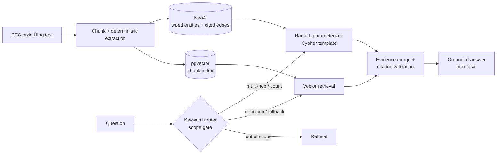

# Knowledge Graph RAG

**A secure, evidence-first hybrid retrieval system for relationship-rich enterprise data.**

It combines a Neo4j knowledge graph with pgvector retrieval so questions that require traversing
relationships, aggregating facts, or refusing unsupported requests are handled deliberately rather
than by a single similarity search. The included offline SEC-filing demo is fully reproducible with
Docker and requires no API key or network access.

> **Measured on the included synthetic 10-question corpus:** hybrid retrieval scored 10/10 versus
> 2/10 for the deterministic vector-only baseline. This is a small, controlled demo—not a
> production performance claim. See the [benchmark caveats](#benchmark-and-scope).

## Why this exists

Organizations keep critical relationships inside unstructured documents: supplier dependencies in
filings, ownership links in contracts, policy exceptions in compliance material, and product or
customer dependencies in internal knowledge bases. A standard vector RAG system can retrieve a
passage that *mentions* those things, but it is not designed to calculate or verify the relationship
between them.

That creates three practical problems:

- **Analysts cannot reliably ask relationship questions.** Questions such as “Which suppliers are
  shared by these two manufacturers?” require traversing and intersecting facts, not finding one
  similar paragraph.
- **Teams cannot audit why an answer was returned.** A plausible LLM response is not enough when
  the answer informs research, procurement, compliance, or operations.
- **A chatbot may answer when it should stop.** Unrelated or unsupported requests should be
  explicitly refused rather than filled with a convincing but ungrounded response.

Knowledge Graph RAG addresses these gaps by storing extracted entities and relationships in a
graph, keeping the supporting document chunk on every relationship, and combining graph traversal
with document retrieval. It is a prototype for relationship-aware, evidence-first enterprise Q&A.

## Where it fits in an organization

This system is best used behind an existing research, operations, or knowledge-assistant workflow;
it is not a replacement for the team’s source systems or human review. A typical workflow is:

| Step | Team action | What the system contributes |
| :--- | :--- | :--- |
| 1. Select a document domain | Choose governed documents, such as filings, contracts, vendor records, or policies. | Defines the allowed answer boundary. |
| 2. Ingest and extract | Load documents on a scheduled or event-driven basis. | Chunks text, resolves entities, and writes cited relationships plus searchable passages. |
| 3. Ask through the existing tool | An analyst uses an internal portal, research workflow, or API. | Routes relationship/count questions to the graph and passage questions to vector retrieval. |
| 4. Review evidence | The analyst sees the answer, source chunks, route, and query metadata. | Makes the result inspectable instead of asking users to trust a model. |
| 5. Escalate uncertainty | A user receives a refusal or insufficient-evidence result. | Creates a clear human-review or source-data follow-up rather than a fabricated answer. |

### Example adoption paths

- **Procurement and supply-chain research:** connect supplier, manufacturer, and dependency facts
  across filings and vendor documents before analysts make a sourcing decision.
- **Compliance and legal operations:** trace policy obligations, entities, and document citations
  while keeping the source of each relationship available for review.
- **Enterprise research teams:** provide an internal research assistant that can answer “who is
  connected to whom?” as well as ordinary document-definition questions.

### Practical onboarding plan

1. **Pilot one narrow document set.** Start with a bounded, non-sensitive corpus and a small set
   of high-value relationship questions. The included SEC-style corpus demonstrates this step.
2. **Define the ontology and evidence standard.** Agree on entity types, relationship labels,
   source retention, and what qualifies as an answerable question before ingesting production data.
3. **Integrate with the organization’s access boundary.** Put the FastAPI service behind existing
   authentication, authorization, audit logging, and network controls; keep document access scoped
   to the requesting user or team.
4. **Run a measured evaluation.** Build a representative golden set, compare against the current
   retrieval approach, and review failures with domain experts.
5. **Operate it as a decision-support tool.** Monitor refusals, citation defects, ingestion health,
   latency, and feedback; keep humans responsible for consequential decisions.

The current repository implements the prototype and evaluation foundation for steps 1–2. The
authentication, tenant controls, production embeddings, operational monitoring, and larger
evaluation set needed for steps 3–5 are intentionally not claimed as complete here.

## End-to-end pipeline

The system has two connected pipelines: one prepares the organization’s documents for retrieval;
the other answers a user’s question only when it has evidence.

### 1. Document-to-knowledge pipeline

```text
Approved document sources
        ↓
Chunk document text into stable, content-addressed passages
        ↓
Extract entities and typed relationships
        ↓
Resolve duplicate names and assign canonical identities
        ↓
Write cited relationships to Neo4j + passages to pgvector
        ↓
Run ingestion checks and record the resulting corpus version
```

| Stage | Input | Output | Why it matters in an organization |
| :--- | :--- | :--- | :--- |
| Source approval | Documents selected by the business owner | A governed corpus | Prevents the assistant from treating every file share as trusted knowledge. |
| Chunking | Raw document text | Stable `chunk_id` passages | Lets every later answer point to a precise source. |
| Extraction and resolution | Chunks plus a domain ontology | Canonical entities and typed edges | Turns phrases such as “TSMC supplies NVIDIA” into a queryable relationship. |
| Dual storage | Entities, edges, and passages | Neo4j graph + pgvector index | Supports relationship traversal and passage retrieval side by side. |
| Quality gate | Ingestion report and sample checks | Approved corpus version | Gives the team a point to review extraction quality before users query it. |

The included implementation uses a deterministic offline extractor and synthetic SEC-style
filings. For an organizational rollout, replace the source adapter and extraction policy with the
approved domain sources, schema, and review process for that team.

### 2. Question-to-evidence pipeline

```text
User question
        ↓
Scope and intent check
        ↓
Graph traversal, vector retrieval, or refusal
        ↓
Merge only the retrieved evidence
        ↓
Generate an answer with chunk citations
        ↓
Validate citations → return answer, retry once, or refuse
```

| Question type | Example | System action | User receives |
| :--- | :--- | :--- | :--- |
| Relationship | “Who supplies NVIDIA’s foundry?” | Runs an allowlisted graph template. | Relationship answer plus cited source chunk. |
| Multi-hop / intersection | “Which companies connect to both NVIDIA and AMD?” | Traverses and intersects graph relationships. | Connected entities plus their supporting evidence. |
| Aggregation | “How many relationships does TSMC have?” | Counts graph edges instead of asking a model to estimate. | A reproducible count and evidence. |
| Definition | “What is a lithography system?” | Retrieves relevant passages from the vector index. | Grounded passage-based answer with citations. |
| Unsupported | “What is the weather in Paris?” | Stops at the scope gate. | An explicit refusal, not a fabricated answer. |

### How it connects to a real workflow

```text
Document system or data lake
        → scheduled ingestion job
        → graph + vector stores
        → internal research portal / analyst workspace / API client
        → cited answer or human-review queue
```

An organization can keep its current document repository and analyst tools. This project becomes a
retrieval service behind them: the source system supplies documents, an approved job ingests them,
and a portal or workflow tool calls the API. Refusals, missing evidence, and user feedback should
be routed to the existing research, data-quality, or compliance review process.

## Why this project is worth a look

- **Solves a real RAG failure mode:** multi-hop, intersection, and count questions need explicit
  relationship traversal, not merely semantically similar text.
- **Makes answers inspectable:** every graph edge records the source `chunk_id`; answers expose
  their route, query template, evidence, citations, and citation-validation report.
- **Treats unsafe behavior as a product problem:** out-of-scope questions are refused, generated
  Cypher is never executed, and uncited or fabricated answers are retried once then refused.
- **Is designed for reproducibility:** one pipeline powers the CLI, API, and benchmark; CI runs
  linting, unit tests, and a live Neo4j schema verification job.

## Architecture



The router never sends model-produced Cypher to Neo4j: it selects only from an allowlisted
catalogue of named query templates with bound parameters.

| Question class | Vector-only | Hybrid (graph + vector) | Gap |
| :--- | :--- | :--- | :--- |
| 1-hop (single fact) | 33% | 100% | +67 pts |
| 2-hop (shared supplier) | 50% | 100% | +50 pts |
| Aggregation (count over relations) | 50% | 100% | +50 pts |
| Definition | 100% | 100% | parity |
| Out-of-scope (must refuse) | 0% | 100% | +100 pts |
| **Overall** | **20%** | **100%** | **+80 pts** |

The table is a deliberately small offline evaluation over 8 synthetic filings. It demonstrates the
retrieval design under controlled conditions; it does **not** establish general performance on
real EDGAR data.

## The problem

Vector-only RAG is good at finding *what* a document says. It is bad at questions that require **connecting relationships** across documents:

- *"Who supplies NVIDIA's foundry?"* — needs a graph traversal: NVIDIA ←SUPPLIES← TSMC
- *"Which suppliers do NVIDIA and AMD have in common?"* — two hops, then intersect
- *"How many relationships does TSMC have?"* — an aggregation embeddings cannot answer
- *"What is the weather in Paris?"* — should be refused, not answered with a random passage

Most vector RAG systems return *something* for every question, even when the answer isn't there. This project refuses when there's no evidence, cites the exact passage every claim comes from, and only trusts pre-written, parameterized Cypher templates — never raw model-generated queries.

## How it works

1. **Ingest** filings into Neo4j (graph) and pgvector (vector), side by side.
2. Every relationship is stored with a `chunk_id` — the exact passage that justifies it.
3. A keyword router classifies each question: graph for multi-hop/count questions, vector for definitions, refusal for out-of-scope.
4. Graph results are executed as named Cypher templates with bound parameters (no string interpolation of model output).
5. Grounded generation cites every chunk it uses; uncited or fabricated answers are retried once, then refused.

## What to demo in two minutes

1. Ask a relationship question: `Who supplies NVIDIA's foundry?` The system selects a graph
   template and returns the evidence-backed supplier relationship.
2. Ask an aggregation question: `How many relationships does TSMC have?` The graph performs the
   count instead of asking an LLM to infer it from passages.
3. Ask `What is the weather in Paris?` The scope gate returns a refusal instead of an unrelated
   filing excerpt.

These three prompts show the project’s central design choices: graph traversal when relationships
matter, vector retrieval when passages matter, and refusal when neither is justified.

## Try it offline (no API key, no network)

```bash
# Clone
git clone git@github.com:dgexplores/Knowledge_Graph_RAG.git
cd Knowledge_Graph_RAG

# Start infra
docker compose up -d neo4j postgres

# Seed schema
python scripts/seed_neo4j.py

# Install deps
pip install -r requirements.txt

# Ingest the demo corpus
export NEO4J_PASSWORD=kg_rag_local_dev_2026
python -m kg_rag.cli ingest --sample

# Ask
python -m kg_rag.cli ask "Who supplies NVIDIA's foundry?"
python -m kg_rag.cli ask "Which suppliers do NVIDIA and AMD have in common?"
python -m kg_rag.cli ask "How many relationships does TSMC have?"
python -m kg_rag.cli ask "What is the weather in Paris?"
```

Or run the FastAPI service:

```bash
python3 -m kg_rag.api         # or: uvicorn kg_rag.api:app
```

Then open [http://localhost:8000](http://localhost:8000). The interactive dashboard lets a visitor
load the demo corpus, use curated prompts, and inspect the selected route, citations, and retrieval
evidence without calling the API manually. The JSON endpoints remain available at `/docs` and
`/health`.

## What's done

| Component | Status |
| :--- | :--- |
| Neo4j + pgvector infra (`docker-compose.yml`, `scripts/seed_neo4j.py`) | ✅ running |
| Entity extraction + resolution (`extract.py`, `resolve.py`) | ✅ deterministic offline path |
| Graph write with typed relationship labels (`store.py`) | ✅ verified against live Neo4j |
| pgvector index + HNSW search (`index.py`) | ✅ verified |
| Named Cypher template catalogue (`cypher_templates.py`) | ✅ no raw model-generated queries |
| Keyword router + out-of-scope refusal (`router.py`) | ✅ |
| Grounded generation + citation enforcement (`answer.py`, `merge.py`) | ✅ |
| End-to-end pipeline + CLI (`pipeline.py`, `cli.py`) | ✅ `demo`, `bench`, `ask`, `ingest` |
| FastAPI service + showcase UI (`api.py`, `kg_rag/static/`) | ✅ interactive local walkthrough plus `POST /ask`, `POST /ingest`, `GET /health` |
| Strict per-class benchmark (`eval_runner.py`, `eval/question_set.jsonl`) | ✅ hybrid 10/10 vs vector 2/10 |
| Tests (154 in the committed CI run) + ruff lint clean | ✅ |
| Benchmark snapshot (`docs/07-benchmark.md`) | ✅ committed |

## Benchmark and scope

The committed benchmark is intentionally narrow: 10 questions over 8 synthetic filings, with a
deterministic `HashingEmbedder` standing in for a learned embedding model. Its useful conclusion
is that the graph route handles the included multi-hop and aggregation cases while the vector-only
baseline does not. It should not be read as a claim about production EDGAR accuracy, a trained
embedding baseline, or real-world latency. The full method, command, results, and caveats are in
[docs/07-benchmark.md](docs/07-benchmark.md).

## Resume-ready description

**Knowledge Graph RAG — Python, FastAPI, Neo4j, PostgreSQL/pgvector, Docker**
Built an evidence-first hybrid RAG system for SEC-style filings that routes relationship and
aggregation questions to parameterized Neo4j templates, uses pgvector for passage retrieval, and
enforces citation-backed answers or explicit refusals. Implemented a reproducible 10-question
evaluation harness; on the included synthetic corpus, the hybrid system scored 10/10 versus 2/10
for the deterministic vector-only baseline.

For interviews, lead with the trade-off: graph traversal adds infrastructure and routing
complexity, but gives reliable multi-hop answers, auditable relationship provenance, and safe
aggregation that similarity search alone cannot provide.

## What's left

- **Real EDGAR ingestion** — `sec_client.py` exists but needs a real `SEC_USER_ACCESS` with a contact email; `budget` command should refuse runs over `MAX_INGESTION_USD`.
- **Real embedding model** — `HashingEmbedder` is a deterministic stub; pgvector column exists but is unpopulated.
- **50–100 stratified questions** — currently a 10-question demo set.
- **Production UI and access controls** — the repository includes a local showcase UI; an
  organization-facing UI still needs authentication, authorization, and integration with its
  existing workflow.

## Repo structure

```
kg_rag/          # pipeline code (config, extract, resolve, store, ingest, index, extract, router, answer, merge, pipeline, cli, api)
tests/           # 154 unit + API tests
scripts/         # seed_neo4j.py
docker-compose.yml
eval/question_set.jsonl
docs/            # PROGRESS.md, 02-data-model.md, 07-benchmark.md
```

## License

MIT. See `LICENSE` for details.
