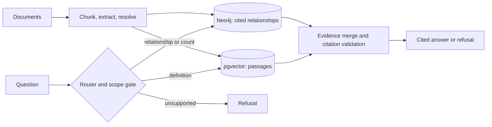

# Knowledge Graph RAG

> Evidence-first RAG for questions about relationships inside enterprise documents.

Knowledge Graph RAG combines a Neo4j knowledge graph with pgvector passage retrieval. It answers
relationship, multi-hop, and count questions with source evidence, while refusing questions that
the document corpus cannot support. The repository is an end-to-end, portfolio-quality prototype;
it is not claimed to be production-ready.

**Implementation status (2026-10-20):** the local prototype, sample corpus, API, and showcase are documented below; no public deployment is configured. CI is now passing after the package/build and database-test fixes. Local verification also passes the full API integration suite (6/6) with Neo4j and PostgreSQL running, plus 148 unit tests without those services.

## Why this exists

Organizations keep important relationships in unstructured documents: supplier dependencies in
filings, obligations in contracts, ownership links, policy exceptions, and product/customer
dependencies. A vector-only RAG system can find a related paragraph, but it cannot reliably follow,
intersect, or count those relationships.

This causes three problems: analysts cannot trust multi-hop answers, reviewers cannot see why an
answer was returned, and a chatbot may answer when it should say it has no evidence. This project
stores entities and typed relationships in a graph, attaches the supporting source chunk to each
relationship, and uses retrieval only when a passage is the right evidence.

## What it resolves

| User question | System path | Outcome |
| :--- | :--- | :--- |
| Who supplies NVIDIA’s foundry? | Graph traversal | Suppliers with cited source chunks |
| Which companies connect to both NVIDIA and AMD? | Multi-hop graph intersection | Shared entities with provenance |
| How many relationships does TSMC have? | Graph aggregation | Reproducible count, not an LLM estimate |
| What is a lithography system? | Vector retrieval | Grounded definition from passages |
| What is the weather in Paris? | Scope refusal | No fabricated answer |

Graph queries are selected from an allowlisted, parameterized Cypher catalogue. The system never
executes raw model-generated Cypher.

## End-to-end pipeline

### Document-to-knowledge pipeline

```text
Approved document sources
  → stable document chunks
  → entity and relationship extraction
  → entity resolution
  → Neo4j cited relationship graph + pgvector passage index
  → ingestion review and approved corpus version
```

| Stage | Input | Output | Why it matters |
| :--- | :--- | :--- | :--- |
| Source approval | Governed documents | Allowed corpus | Defines what the assistant may answer about. |
| Chunking | Document text | Stable `chunk_id` passages | Makes every answer traceable to a precise source. |
| Extraction and resolution | Chunks and domain ontology | Canonical entities and typed edges | Turns document statements into queryable relationships. |
| Dual storage | Entities, edges, passages | Neo4j and pgvector | Supports relationship and passage questions together. |
| Quality gate | Ingestion report | Reviewed corpus version | Lets domain owners check extraction before users query it. |

### Question-to-evidence pipeline

```text
User question
  → scope and intent check
  → graph traversal, vector retrieval, or refusal
  → evidence merge
  → cited answer generation
  → citation validation
  → answer, retry once, or refusal
```

## How an organization uses it

This is a decision-support service behind an existing document repository and analyst workflow;
it does not replace source systems or human review.

```text
Document repository or data lake
  → scheduled ingestion job
  → graph and vector stores
  → internal research portal, analyst workspace, or API client
  → cited answer or human-review queue
```

### Example use cases

- **Procurement and supply chain:** trace suppliers, manufacturers, and dependencies across vendor
  records and filings before a sourcing decision.
- **Compliance and legal operations:** connect policy obligations, entities, and cited source
  material so reviewers can verify a response before acting on it.
- **Research and strategy:** let analysts ask who is connected to whom alongside normal document
  definition questions.

### Organizational onboarding

1. Choose a narrow, governed pilot corpus and a short list of high-value relationship questions.
2. Define entity types, relationship labels, evidence-retention rules, and answerability criteria.
3. Connect the approved document source and establish an ingestion review process.
4. Put the API behind the organization’s authentication, authorization, audit, and network controls.
5. Build a domain-specific evaluation set and review failures with subject-matter experts.
6. Monitor ingestion health, refusals, citation defects, latency, and feedback; route uncertainty to
   the existing review process.

The repository implements the prototype foundation for the first two steps. Real source connectors,
learned embeddings, access controls, monitoring, and larger domain evaluations are future work.

## Architecture



## Demo and quick start

Prerequisites: Python 3.11+, Docker, Neo4j, and PostgreSQL with pgvector through Docker Compose.

```bash
git clone git@github.com:dgexplores/Knowledge_Graph_RAG.git
cd Knowledge_Graph_RAG
docker compose up -d neo4j postgres
python3 scripts/seed_neo4j.py
pip install -r requirements.txt
export NEO4J_PASSWORD=kg_rag_local_dev_2026
python3 -m kg_rag.cli ingest --sample
python3 -m kg_rag.cli ask "Who supplies NVIDIA's foundry?"
```

For the local showcase UI:

```bash
NEO4J_PASSWORD=kg_rag_local_dev_2026 python3 -m uvicorn kg_rag.api:app --port 8010
```

Open `http://127.0.0.1:8010`, load the demo corpus, and run a guided question. The showcase
displays the routing decision, answer, citations, and evidence.

## Evaluation and scope

On the included synthetic corpus of 8 filings and 10 questions, the hybrid path scored **10/10**
and the deterministic vector-only baseline scored **2/10**. This is a controlled demonstration of
the retrieval design, not a production accuracy claim. See [docs/07-benchmark.md](docs/07-benchmark.md).

## Implemented

- Neo4j graph schema and pgvector passage index
- Deterministic extraction, entity resolution, and idempotent sample ingestion
- Named, parameterized Cypher templates, routing, scope refusal, and citation enforcement
- CLI, FastAPI API, local showcase UI, benchmark harness, CI workflow, and tests

## Production work remaining

- Real document-source connectors and approved ingestion workflows
- Learned embedding model and production embeddings
- Authentication, authorization, tenant isolation, audit logging, rate limiting, and monitoring
- Production deployment, backup/recovery, and a larger expert-reviewed evaluation set

## Resume description

**Knowledge Graph RAG — Python, FastAPI, Neo4j, PostgreSQL/pgvector, Docker**

Built an evidence-first hybrid RAG system for SEC-style filings that routes relationship and
aggregation questions to parameterized Neo4j templates, uses vector retrieval for passage
questions, and returns cited answers or explicit refusals. Built ingestion, evaluation, API, and
interactive showcase workflows.

## License

MIT. See [LICENSE](LICENSE).
